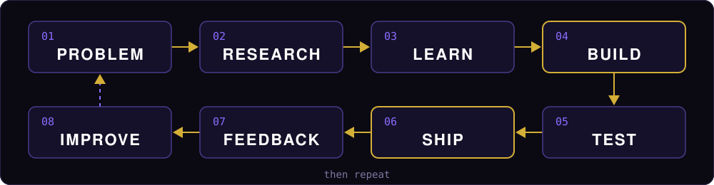
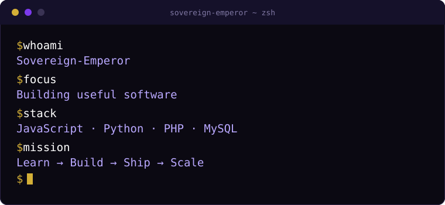

<!-- HERO -->

  

  

  
  
  

<!-- NAVIGATION -->

  
  
  
  
  

  

 

<!-- ABOUT -->

## 👑 About

I'm a **Computer Science student** learning software engineering by building practical projects. I enjoy turning ideas into useful digital products and improving my skills through hands-on work.

Right now, I'm strengthening my foundations in web development, backend programming, databases, and software design. I'm especially interested in full-stack development and thoughtful uses of AI.

<!-- CURRENT FOCUS -->
- 🔭 **Building:** Practical web projects and product experiments
- 🌱 **Learning:** JavaScript, Python, React, backend development, and databases
- 🧠 **Exploring:** AI/ML, full-stack development, and software architecture
- 🎯 **Focused on:** Turning ideas and technical skills into useful products
- 🚀 **Long term:** Technology, entrepreneurship, and ownership

<!-- TECH STACK -->

## ⚡ Tech Stack

> A direction, not a trophy case. The notes show what I'm building with, learning, or exploring.

   
  <strong>Frontend</strong> 
  Building with HTML, CSS, and JavaScript · Learning React

   
  <strong>Backend</strong> 
  Building with Python and PHP · Exploring Node.js

   
  <strong>Databases</strong> 
  Building with MySQL · Learning PostgreSQL

   
  <strong>Tools</strong> 
  Building with Git and GitHub · Exploring Linux

<strong>AI &amp; ML</strong> · Exploring Python, AI APIs, and machine-learning fundamentals

<!-- HOW I BUILD -->
## ⚡ How I Build

  

> *I learn with a destination: build something useful, get feedback, and make it better.*

<!-- TERMINAL -->

  

<!-- FEATURED PROJECTS -->

## 🚀 Featured Projects

### 👑 Sovereign Emperor Digital Library

An in-progress digital knowledge platform concept for bringing books, courses, PDFs, and coding resources into one place. I'm exploring resource discovery, responsive interfaces, and full-stack product design.

`Digital Library` `Web Development` `EdTech` · **Status:** 🚧 In development

[Preview →](https://sedilib.netlify.app/) · [Source code →](https://github.com/Sovereign-Emperor/digi-market-store)

### 🌐 Personal Developer Portfolio

A home for my projects, experiments, technical interests, and ways to connect.

`HTML` `CSS` `JavaScript` · **Status:** 🚧 In progress

[Visit portfolio →](https://sovereign-emperor-portfolio.netlify.app/)

<!-- PROJECT SOVEREIGN -->
## 👑 Project Sovereign

My long-term framework for building the skills and discipline to turn useful ideas into products.

**LEARN** → **BUILD** → **VALIDATE** → **SHIP** → **EARN** → **SCALE** → **OWN**

> *Find real problems. Build useful solutions. Get them into the hands of real people.*

**Long-term vision.** Sovereign Empire represents my ambition to combine technology, entrepreneurship, and product building. I'm exploring digital commerce, software, AI, education, and technology opportunities in African markets.

<!-- LEARNING ROADMAP -->

## 🧭 Learning Roadmap

> A direction, not a claim that every item is mastered.

- **01 · Foundations:** HTML, CSS, JavaScript, Git/GitHub, programming fundamentals, and databases
- **02 · Modern web:** React, TypeScript, APIs, backend development, authentication, and PostgreSQL
- **03 · Engineering:** Data structures, algorithms, architecture, testing, security, Linux, Docker, and deployment
- **04 · AI:** Python, AI APIs, LLMs, automation, and machine learning
- **05 · Build:** Real users, useful products, meaningful problems, and sustainable value

<!-- GITHUB STATS -->
## 📊 GitHub Activity

  
  
    
  

<!-- SOCIAL LINKS / CONNECT -->

## 🤝 Connect

**Have an idea, project, or interesting problem? Let's build something useful.**

  
  
  
  
  

<!-- FOOTER -->
 

  Learn → Build → Validate → Ship → Improve → Repeat  

  

